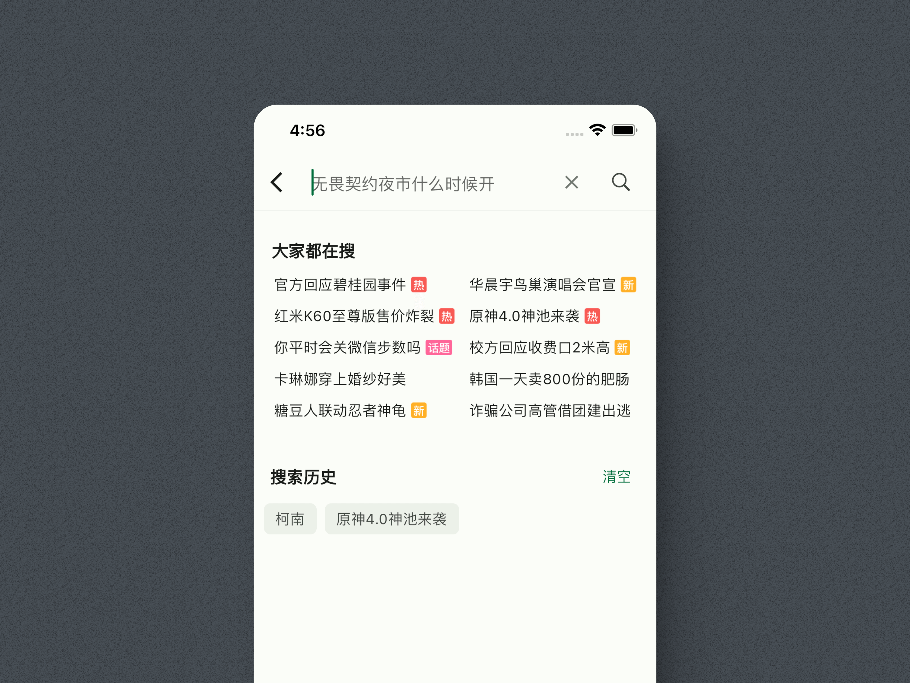
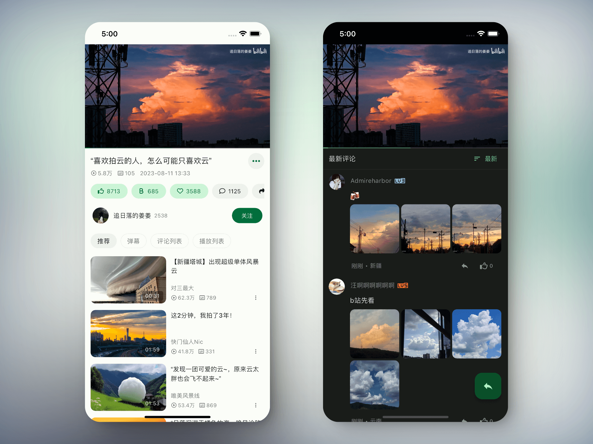
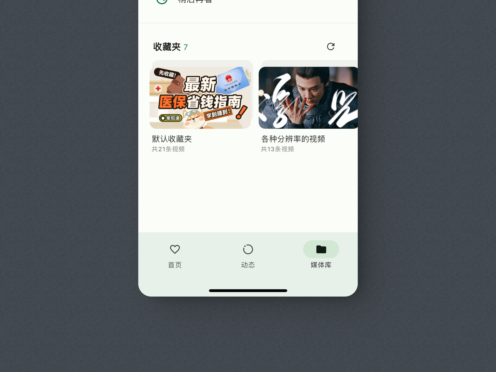
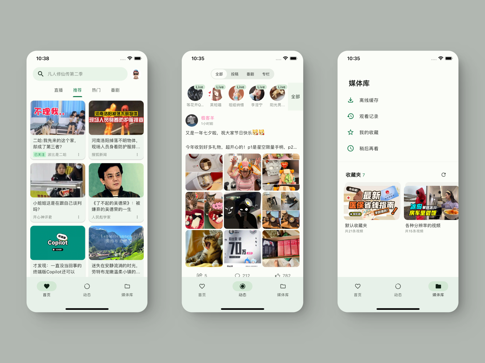

    

    <h1> PiliMax </h1>

    

    
 PiliPlus 第三方 Fork 自用版本，大部分修改针对 Android 平台 

    
 其他平台构建时也会顺便一起构建，大概率有 BUG ，如有需要请自行 Fork 后修改编译 

 

 

 

## 项目说明
- 本项目 PiliMax 是基于上游项目 PiliPlus 及 PiliNara 的个人自用版本，保留主要功能并进行了一些自用优化和调整。
- 本项目大部分修改针对 Android 平台，其他平台也会顺便一起构建，但是大概率有 BUG ，需自行测试。
- 本项目仅供个人学习和测试使用，如有需要请自行 Fork 后修改编译。
- 本项目会按需同步上游更新，并在此基础上进行修改和优化。

在此致敬原项目作者和上游项目作者的无私奉献。

# 近期改动
## 本项目特性（相对上游的新增与增强）
### 界面与交互

- [x] 外观与导航：悬浮底栏提供普通、柔光玻璃和液态玻璃三种样式，可调节液态玻璃强度、底部间距及文字显示；增加首页背景渐变和按宽度自动切换侧边栏。
- [x] 字体管理：支持导入、删除和持久保存 TTF、OTF、TTC 字体；弹幕字体可跟随界面或独立选择，界面可调节字重、字号及是否跟随系统字号。
- [x] 页面转场：协调视频卡片展开、详情页骨架与播放器交接；完善图片预览 Hero 动画，以及 Android 视频、评论、回复和预览弹窗的预测性返回。
- [x] Android 页面恢复：应用被系统回收后，可恢复 24 小时内记录的受支持单个页面及主页导航、首页标签；恢复范围为页面入口与部分状态。
- [x] 图片与封面体验：优化宽屏动态图片网格、长图比例、图片预览转场和封面预览信息；图片长按或右键菜单支持复制图片，并将保存图片置于更易访问的位置。
- [x] 剪贴板跳转：移动端可选在启动或返回前台时识别并打开剪贴板中的哔哩哔哩视频链接。
- [x] 关注与搜索：关注搜索支持输入联想和空状态清理；视频、专栏等搜索结果支持包含或排除关键词筛选，并完善综合搜索分组展示。
- [ ]  其他，等等...

### 播放与直播

- [x] 应用内小窗：视频和直播支持应用内悬浮播放，可拖动位置、双指缩放，并处理小窗与原视频页之间的播放器状态交接。
- [x] 小窗与系统画中画衔接：优化视频源切换、返回时的封面和首帧过渡；应用内小窗转 Android 系统画中画为实验性功能，表现受系统和机型影响。
- [x] 听视频体验强化：完善视频与听视频模式之间的分集、进度、播放状态、后台媒体信息和播放完成后的连续播放同步。
- [x] 播放控件细节：支持设置手动切集后保持播放控件显示；全屏锁定按钮可移至右侧，锁定后可禁止重力旋转，并显示当前分 P 弹幕数。
- [x] 播放手势与画面调节：视频画面双指缩放可选同时旋转，松手吸附到直角；支持亮度、对比度、饱和度、伽马、色相和音频延迟调节及重置，效果取决于设备和输出驱动。
- [x] 键盘操作：完善播放器与内容区域的焦点分配，支持方向键、PageUp/PageDown 和长按滚动，并扩展逗号、句号调速的适用范围。
- [x] 音量与音频策略：移动端可使用应用内音量而不改变系统音量，并可选最高 200% 音量增强；支持与其他应用混合播放音频。部分系统的媒体控制能力可能受平台限制。
- [x] 自动播放与画质：可限制仅在 Wi-Fi 下进入详情页时首次自动播放；移动端支持单独设置半屏默认画质，并按网络环境选择全屏画质。
- [x] 播放失败兜底：完善网络错误分类、重试和解码失败处理；Android 在线视频解码失败时尝试其他可用编码，并尽量保留当前播放进度。
- [x] 试看适配：提供“无限试用试看画质”选项，仅忽略客户端试用次数；是否能获取可播放流仍由官方接口、账号权限和视频条件决定。
- [x] 双语字幕：支持主、副字幕双轨选择，分别调节字号、全屏字号、字重、描边和背景，并设置两轨间距；需要提供或加载对应字幕源。
- [x] 高能进度条：可选择官方优先、仅弹幕密度、只用官方或关闭；官方数据缺失时，可根据弹幕列表生成热度曲线。
- [x] 直播播放增强：优化直播仅音频与画面切换、后台播放、中断恢复和播放停滞检测；支持直播 DLNA 投屏和未开播房间的聊天室入口。
- [x] 直播醒目留言：支持选择发送时间的显示策略，包括仅常驻时显示、始终显示或隐藏。
- [ ]  其他，等等...

### 推荐、动态与社区

- [x] 推荐来源模式：在 App 端和 Web 端推荐基础上增加合并模式，并调整推荐刷新保留内容及上次浏览位置提示的处理。
- [x] 推荐过滤扩展：增加 UP 名关键词、独立屏蔽名单、共享白名单和无权查看视频过滤；可扩展至热门、分区、搜索和相关视频，各场景支持的条件及关注豁免范围不同。
- [x] 动态布局：动态页可在顶部分类栏和按 UP 主滑动的页面布局之间切换，并完善 UP 主切换、未读标记和分页刷新。
- [x] 动态过滤扩展：在关键词与带货过滤基础上，新增独立屏蔽名单、共享白名单，以及无权查看内容、充电专属视频和动态视频过滤；独立名单与动态视频过滤仅作用于非 UP 主分页。
- [x] 评论过滤增强：增加评论独立屏蔽、共享白名单和用户等级过滤；可保留 UP 主自己的评论、置顶评论及 UP 主点赞或回复的评论，并完善屏蔽与豁免优先级。
- [x] 评论交互与发评反诈：可交换点赞、点踩按钮位置，单独设置楼中楼默认排序；完善内置发评可见性检查、外部反诈兼容及评论、动态发送后的状态提示。
- [x] 过滤规则管理：支持列表编辑与逐项正则校验；加载历史规则时跳过无效项，避免单条错误导致整组过滤失效。
- [x] 弹幕“+1”：视频和直播弹幕支持一键复读发送；需要登录，并受平台发送限制影响。
- [x] 弹幕展示细节：相同文本合并后的数量标记可隐藏、前置或后置，并可设置显示门槛；完善空弹幕和加载失败提示。
- [x] 动态与文章细节：完善动态分享链接、游戏动态解析、刷新和红点同步，以及文章图片、长图比例和预览跳转。
- [ ]  其他，等等...

### AI、下载与数据管理

- [x] AI 视频助手：自备 OpenAI 兼容 API，可配置模型和提示词模板，基于标题、简介及字幕总结、分析和多轮追问。
- [x] 支持流式回答、Markdown、LaTeX 和时间戳跳转，接口与模型支持时可展示推理内容、设置推理强度；无字幕时仅使用标题与简介。
- [x] 离线下载管理：扩展下载入口，优化队列调度和进程被杀后的等待任务续下；支持设置并行任务数、禁止移动流量下载、文件夹分类、手动排序和多选归类，区分移除分类与删除缓存；Android 支持批量导出缓存目录。
- [x] WebDAV 连接：设置变更后自动使用新配置重连，并兼容 PiliMax 与旧版文件名进行设置备份和恢复。
- [x] 设置迁移：设置导入导出加入来源和版本信息，兼容旧键并保留本地设置；导入失败支持回滚，默认跳过 API Key 和 WebDAV 密码等敏感项。
- [x] 自动缓存清理：支持按 1、3、7、15、30 天周期清理应用自身缓存，并可设置网络图片缓存上限；不会主动清理应用不拥有的文件。
- [x] 设置组织与搜索：统一动态、评论等设置分组，支持按标题、说明及关联关键词搜索并定位设置项。
- [ ]  其他，等等...

### 存储、账号与维护

- [x] 本地存储：Android 引入 MMKV 和旧数据迁移；存储异常时可重试，符合条件时可备份并重置对应数据，不承诺自动恢复损坏数据。
- [x] 账号与登录：增加网页登录获取 Cookie，完善手动 Cookie 导入校验；匿名及登录账号可分别设置 buvid，账号数据加密保存，密钥由平台安全存储管理。
- [x] 崩溃与诊断：增加异常报告历史、Android 原生崩溃及进程退出信息采集，支持日志查看、脱敏导出和清理，并可单独控制网络日志；本地诊断入口按构建配置提供。
- [x] 空降助手增强：在上游 SponsorBlock 基础上加入内存缓存、请求去重、失败状态、受控重试、手动刷新和续播误跳保护；是否能跳过片段取决于服务和社区标记。
- [x] CDN 与网络适配：支持自定义 CDN、按地区选择和刷新节点，并校验远程节点域名；完善代理配置校验、网络配置更新和请求异常处理。
- [x] 更新检查：可选检测预发布版本，支持跳过指定版本的自动更新提示；Android 优先匹配设备支持的安装包架构，缺失时尝试通用包。
- [ ]  其他，等等...

> 本项目大部分修改针对 Android，其他平台需自行测试；部分功能受系统版本、设备能力、网络、B 站接口和账号权限影响。

 

## 下载

- 可以通过右侧 [releases](https://github.com/ekmope/PiliMax/releases) 进行下载或拉取代码到本地进行编译

 

## 声明

此项目（PiliMax）是个人为了兴趣而开发，仅用于学习和测试，请于下载后 24 小时内删除。
所用 API 皆从官方网站收集，不提供任何破解内容。
- 在此致敬原作者：[guozhigq/pilipala](https://github.com/guozhigq/pilipala)
- 在此致敬上游作者：[orz12/PiliPalaX](https://github.com/orz12/PiliPalaX)
- 在此致敬上游作者：[bggRGjQaUbCoE/PiliPlus](https://github.com/bggRGjQaUbCoE/PiliPlus)
- 在此致敬上游作者：[Starfallan/PiliNara](https://github.com/Starfallan/PiliNara)
- 在此致敬上游作者：[staoran/PiliPlus](https://github.com/staoran/PiliPlus)
- 在此致敬上游作者：[Chloemlla/PiliPlus](https://github.com/Chloemlla/PiliPlus/)
- 其他众多 Flutter 项目仓库，等等...
- 本仓库在前作的基础上做了一些自用修改，感谢原作者及其它作者的开源精神。

感谢您的支持及使用。
如有侵权请联系 [ekmope@163.com](mailto:ekmope@163.com) 删除。

 

## 致谢

- [bilibili-API-collect] (https://github.com/SocialSisterYi/bilibili-API-collect)
- [flutter_meedu_videoplayer] (https://github.com/zezo357/flutter_meedu_videoplayer)
- [media-kit] (https://github.com/media-kit/media-kit)
- [dio] (https://pub.dev/packages/dio)
- 等等

 
 
 
